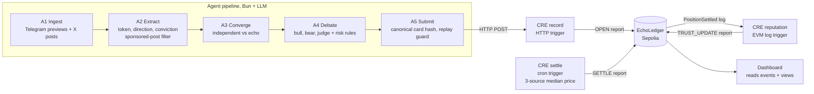

# Echo Ledger

[](https://github.com/nguyenkhangph/echo-ledger/actions/workflows/ci.yml)

**Filter the echo. Record the signal.**

Echo Ledger is an AI agent that watches public crypto voices (KOLs), works out which of them are saying something *independently* and which are just repeating someone else, checks the claim against market data, argues it out in a bull/bear/judge debate, and then opens a **practice** position. Every decision produces a *reasoning card*, and the card's hash, the settlement and the resulting change in each source's trust score are written to Ethereum Sepolia by **Chainlink CRE** workflows.

The point is accountability: anyone can recompute a card's hash from its contents and check it against the chain, and every source's track record is public and cannot be edited after the fact.

> Practice positions only. No real capital, no exchange keys, not financial advice.

---

## Judge's 3-minute path

1. **Open [echoledger.fun](https://www.echoledger.fun).** The four numbers under the headline (practice PnL, audit checks, decisions, trust updates) are read from Sepolia and re-derived in your browser.
2. **Echo Graph:** it opens on BTC, 26 Oct. A bot that counts reposts scores 0.67 and trades; Echo Ledger discounts the echo, scores 0.50 and holds back.
3. **Chainlink CRE section:** three workflows (HTTP → record, Cron → settle, EVM log → reputation), with live report counts and the latest transaction of each.
4. **Independent audit → Try to tamper:** turn a loss into a win or inflate a trust score in a private copy of the data and watch the checks fail.
5. **§ certificate** on any position: a printable Certificate of Record with the grounds for the decision, the sources relied on and the chain of custody.
6. **Compliance map:** each feature matched to EU AI Act Art. 12/13, MiCA Art. 91 and FTC §255.5, with evidence links.
7. **Check it without us:** `bun install && bun run verify` reads the contract and re-derives everything.

> If the public Sepolia RPC is slow, the site shows the bundled copy of the ledger (block and time are printed) until the live read succeeds.

---

## On-chain proof (Ethereum Sepolia)

Contract **EchoLedger** [`0x88fd1895d9b4BD28Cf641281b9AA1eF787b8DAd0`](https://sepolia.etherscan.io/address/0x88fd1895d9b4BD28Cf641281b9AA1eF787b8DAd0), written through the CRE simulation forwarder `0x15fC6ae953E024d975e77382eEeC56A9101f9F88`.

### A live decision from real sources

The agent read public Telegram channels, found an independent bullish BTC narrative, debated it and opened a practice long. Each step below was written by a different CRE workflow:

| Step | CRE workflow (trigger) | Transaction | Result |
| --- | --- | --- | --- |
| Open | `record` (HTTP, posted by the agent) | [`0xba6549…683b`](https://sepolia.etherscan.io/tx/0xba6549c2fb6f5ded676ed5d15df1b185c6685b150998475d9484592e71ea683b) | `PositionOpened`: BTC long (block 12004347, 27 Oct) |
| Settle | `settle` (cron) | [`0xd7c1b6…b362`](https://sepolia.etherscan.io/tx/0xd7c1b6ebafaf4a271d8af6b63fc03db1ec3d870d17b496d54ed7f1853a30b362) | `PositionSettled` at the 24 h horizon, **+234 bps** (block 12011543, 28 Oct) |
| Trust update | `reputation` (EVM log) | [`0xa452f5…2f28`](https://sepolia.etherscan.io/tx/0xa452f537347113d5c0bd61b9716bbbdcce94df3a8779cc5c1837884750ef2f28) | `TrustUpdated`, 5000 → 5250, for the four sources behind the call: Wu Blockchain, Glassnode, The Daily Hodl and CryptoQuant (block 12011544, the next block) |

All live decisions so far (every one is a BTC call from real Telegram sources):

| Opened | Decision | Open tx | Settle tx | Result | Trust update |
| --- | --- | --- | --- | --- | --- |
| 27 Oct, block 12004347 | APPROVE, long 2.5 % | [`0xba6549…683b`](https://sepolia.etherscan.io/tx/0xba6549c2fb6f5ded676ed5d15df1b185c6685b150998475d9484592e71ea683b) | [`0xd7c1b6…b362`](https://sepolia.etherscan.io/tx/0xd7c1b6ebafaf4a271d8af6b63fc03db1ec3d870d17b496d54ed7f1853a30b362) | **+234 bps** | [`0xa452f5…2f28`](https://sepolia.etherscan.io/tx/0xa452f537347113d5c0bd61b9716bbbdcce94df3a8779cc5c1837884750ef2f28) |
| 27 Oct, block 12004747 | APPROVE, long 3 % | [`0xcaecb7…8da8`](https://sepolia.etherscan.io/tx/0xcaecb75332aeffed6dea3619d88f26e72b8d4c779d72be8fa19868e7a58c8da8) | [`0x244a07…6bdf`](https://sepolia.etherscan.io/tx/0x244a07b66d3551ff462cebd673abcf55b6a7931a576a6a8fe6669ca167a66bdf) | **+169 bps** | [`0xbf4d5d…e6ae`](https://sepolia.etherscan.io/tx/0xbf4d5d6f4d0c1eecbb527e0e34dc8b2621b114bf97e1678844b6324b60d0e6ae) |
| 27 Oct, block 12005491 | APPROVE, long 3 % | [`0x35e13f…a1b8`](https://sepolia.etherscan.io/tx/0x35e13fe9a8db5fddd11725cbcb8e46700e7780e688640f76df625bb26052a1b8) | [`0x115336…db34`](https://sepolia.etherscan.io/tx/0x115336607aa8bf14f8d6f63b218e42c0417a89acad131f85fc07da93febddb34) | **+72 bps** | [`0x9e95d3…7caf`](https://sepolia.etherscan.io/tx/0x9e95d32305a8fe72165a82016c0cc86073ab8cafc0b4522c863782dad4d67caf) |
| 27 Oct, block 12005688 | REJECT | [`0xacc7f8…788c`](https://sepolia.etherscan.io/tx/0xacc7f8d2ad91a15648260c829beeb94c089e5b888c6822d6a4f89c46e0e0788c) | | recorded, no position | |
| 27 Oct, block 12006794 | REJECT | [`0xdd9baf…f35e`](https://sepolia.etherscan.io/tx/0xdd9baf845a2fc5702ab754b80344b2bad0f46f7d14eb00de8c3f61b6ed21f35e) | | recorded, no position | |
| 28 Oct, block 12014014 | APPROVE, long 2.5 % | [`0x31fc06…7430`](https://sepolia.etherscan.io/tx/0x31fc0653d8ec294c7929e3e5da034b67bb408135a7e78c7b7c54355501de7430) | | open at time of writing | |

After three settled wins, Glassnode, The Daily Hodl and CryptoQuant stand at 5750 trust and Wu Blockchain at 5500.

The first five rows exposed a real flaw: every new post joining the same BTC narrative changed its source set and looked like a new signal, so one story opened three positions before the `max_open` limit stopped it, and the next two attempts, made while those three positions were still open, were recorded as REJECT. The agent now allows one decision per token per horizon (see [Lessons from the live run](#lessons-from-the-live-run)); the sixth decision came only after the previous BTC decision's 24 h horizon had passed. The extra positions stay on chain as recorded.

### Pipeline verification run

Before the live run, one fixture card was pushed through all three workflows to prove the on-chain path:

| Step | CRE workflow (trigger) | Transaction | Result |
| --- | --- | --- | --- |
| Open | `record` (HTTP) | [`0x0e7299…a62d`](https://sepolia.etherscan.io/tx/0x0e729f4a7b02a3f4688bb37f92775992af29dce3423c1611f883951a2219a62d) | `PositionOpened`: SOL, long, APPROVE |
| Settle | `settle` (cron) | [`0x38efa1…eca09`](https://sepolia.etherscan.io/tx/0x38efa182cb2775e6b8e8d51173884d6496adac2f96b81538505f28581c3eca09) | `PositionSettled` at the 24 h horizon, **−81 bps** (block 12002764) |
| Trust update | `reputation` (EVM log) | [`0x7b7459…8ec7b`](https://sepolia.etherscan.io/tx/0x7b7459824750fa355af5c05fe4cdc50559bb0f5b14e1acf202006f627018ec7b) | `TrustUpdated` for both sources, 5000 → 4750 (block 12002765) |

This card is the repository fixture `card-sol-approve-001`; its two sources (`alice-crypto`, `block-research`) are fictional. The transactions, the price-based settlement and the trust penalty are real.

The dashboard reads all of this straight from the contract (no indexer, no backend): the **On-chain ledger** section on the Radar page, the live Scorecard, and a hash check on every reasoning card page that turns green when the locally computed card hash matches a `PositionOpened` event.

---

## How it works



**1. Ingest (A1).** Public Telegram channels are read from their `t.me/s/<channel>` previews; X posts are added to `agent/manual_posts.json` (there is no X API client). Forwards, quotes and replies keep a pointer to the post they reference. A channel that fails to load is skipped with a warning instead of stopping the run.

**2. Extract (A2).** An LLM (any OpenAI-compatible endpoint) turns each post into a structured signal: token, bullish/bearish, conviction, timeframe. Paid promotion is caught by a deterministic guard (disclosure tags, or a bullish push combined with a referral code and a call to action) on top of the LLM's own judgement. Filtered posts are not silently dropped: they go to `fixtures/extraction-audit/` with the reason. Results are cached per post, so each post is extracted once.

**3. Converge (A3).** Signals are grouped by token and direction. A post that quotes, forwards or explicitly attributes another source is an **echo**: it is shown, but it never counts towards the score. A token passes only with a convergence score of at least 0.6 **and** at least two independent sources.

**4. Debate (A4).** A bull, a bear and a judge argue over the evidence (lead time versus price, volume, price agreement across sources). Deterministic risk rules (minimum market cap, maximum open positions, position size) are recorded alongside the verdict as APPROVE, CONSTRAIN or REJECT.

**5. Submit (A5).** The card is serialised canonically and hashed (`shared/src/hash.ts`), deduplicated by signal identity so a restart cannot open the same call twice, and posted to the CRE `record` workflow. Without `CRE_RECORD_URL` this step is a dry run.

**6. Settle and score.** The `settle` workflow checks each open position against a median of CoinGecko, Coinbase and Binance prices and closes it at the 24 h horizon or an 8 % stop loss. The `reputation` workflow reacts to each `PositionSettled` log and moves the trust score of every source in that position up on a win and down on a loss. A source flagged as an echo takes an extra penalty: it never gains from a winning call and loses twice as much on a losing one, so repeating other people cannot build a track record.

---

## Chainlink CRE

Three TypeScript workflows in [`cre/`](cre/), built and run with CRE CLI v1.39.0:

| Workflow | Trigger | Writes | Notes |
| --- | --- | --- | --- |
| [`record`](cre/record/) | HTTP | OPEN report (type 0) | Re-checks the card hash, runs the risk gate against live prices, records APPROVE / CONSTRAIN / REJECT. REJECT is stored for audit but never becomes an open position. |
| [`settle`](cre/settle/) | Cron | SETTLE report (type 1) | Reads `openPositionIds`, prices each token from three sources, settles on horizon or stop loss. A `HOLD` performs no write. |
| [`reputation`](cre/reputation/) | EVM log (`PositionSettled`, finalized) | TRUST_UPDATE report (type 2) | Batched update for every source of the settled position. |

All reports go through `writeReport` to `EchoLedger.onReport` (`ReceiverTemplate` / `IReceiver`).

Two lessons from running this for real, both now covered by code and tests:

- **A successful transaction is not a delivered report.** The first broadcast succeeded at the transaction level, but the forwarder emitted `ReportProcessed(success=false)`: the receiver call had run out of gas, and the ledger was unchanged. Tracing the transaction and replaying it with more gas found the cause. Every workflow now checks `receiverContractExecutionStatus` as well as the transaction status and fails loudly if the receiver reverted.
- **Gas limits come from measurements, not guesses.** Foundry tests with the worst case of 20 sources measure 3.54 M gas for OPEN, 0.43 M for SETTLE and 6.89 M for TRUST_UPDATE. The workflow configs use 5 M, 750 k and 9.5 M.

### Why local simulation and not a deployed DON

Chainlink told us directly that deploying CRE workflows to a testnet or mainnet DON currently requires a commercial agreement with them, and that local simulation is the intended path for hackathon projects. The workflows therefore run with `cre workflow simulate … --broadcast`: the same workflow code, compiled to WASM and executed by the CRE simulator, writing real reports to Sepolia through the simulation forwarder. `record` and `reputation` run as persistent `--listen` processes; `settle` is driven by an operator loop because the simulator executes a cron trigger once per invocation. The full operating procedure is in [`cre/LIVE_RUN.md`](cre/LIVE_RUN.md).

---

## Verify it yourself

Do not trust the dashboard, replay it. One command reads the public Sepolia ledger and re-derives the track record with the same rules the contract and the CRE workflows use:

```bash
bun install
bun run verify                       # live read of the Sepolia ledger
bun run verify --snapshot shared/test/fixtures/ledger-snapshot.json   # the recorded live run, offline
```

It checks, for every decision:

- **Profit and loss** is recomputed from entry and exit price (signed by side, truncated toward zero like the contract).
- **Horizon:** a position closes after 24 h, or earlier only at the 8% stop.
- **Risk:** no opened position is larger than 5%; a REJECT never opens or settles.
- **Reputation:** every `TrustUpdated` event is replayed (+250 on a win, −250 on a loss, −250 more for an echo, clamped) and must equal the score on chain, and the final score and trade count of each source must equal what the contract stores.
- **Timing:** a trust update follows each settlement within 30 minutes.

It exits with code 1 if any check fails. The dashboard runs the same code in the browser:

- **Independent audit** panel with a **Try to tamper** control: edit a private copy of the chain data (turn a loss into a win, inflate a trust score, hide an oversized bet, close a trade early) and watch which checks catch it.
- **Certificate of Record** for every decision (`/record/<positionId>`): particulars, sources relied upon, chain of custody from card hash to trust update, the verification result and a SHA-256 fingerprint of the proof pack. It prints to PDF.
- **Proof pack** download per position: the on-chain record plus the re-derived checks, hashed.
- **Grounds for every decision:** the reason code the CRE risk gate stored (e.g. `1002` price sources disagreed by more than 1%, `1005` the judge decided not to trade) is shown on the ledger and the certificate, and the audit checks that it matches the attestation.
- **Compliance map:** each feature matched to the rule it answers (EU AI Act Art. 12 and 13, MiCA Art. 91(2)(c) and 91(3)(c), FTC 16 CFR §255.5) with a link to the evidence. Illustrative, not legal advice.
- **Composable reputation:** a Solidity and viem snippet for reading `kolTrust` from any contract or agent.
- **Naive vs Echo Ledger** on the Echo Graph: what a bot that counts every repost would have scored, next to the independent-only score. CI runs typecheck, tests, the audit on the recorded run, the dashboard build and the contract tests on every push.

---

## Live run

The agent and all three workflows were run continuously against Sepolia from 26 Oct 2026 (local simulation, five terminals, see [`cre/LIVE_RUN.md`](cre/LIVE_RUN.md)). The watchlist in [`agent/kols.json`](agent/kols.json) holds 19 sources:

- **Telegram, fully automated:** WatcherGuru, Cointelegraph, Wu Blockchain, Lookonchain, The Daily Hodl, CryptoQuant, Glassnode, DaanCrypto, BitcoinBullets.
- **X, via `manual_posts.json`:** TedPillows, AltcoinSherpa, KillaXBT, Morecryptoonl, ZordXBT, CryptoAnup, Ali Martinez, Rekt Capital, and two Vietnamese-language analysts.

The list deliberately mixes large accounts that are often repeated with small independent ones that cover the same tokens, which is exactly where echo detection matters. In the first hours on real data, the agent extracted bearish calls on HYPE and ETH and flagged a bullish BTC post as an echo of another account, so it did not count towards convergence. The next day a bullish BTC narrative passed convergence with independent sources; the resulting position settled at +234 bps and raised the trust of the four sources behind it (see [On-chain proof](#a-live-decision-from-real-sources)).

---

## Lessons from the live run

Running the system for real against Sepolia surfaced problems no test had caught. Each is fixed in code, and all but the stale-read fix (which needs the CRE runtime) have a unit test:

- **One narrative, several positions.** The replay guard keyed on the exact set of source posts, so a growing narrative looked new on every cycle. Decisions are now limited to one per token per horizon.
- **Stale reads after a settlement.** `settle` discovers open positions at the finalized block, about 15 minutes behind the head. For that window a just-settled position still looked open and was sent again; the ledger rejected it inside the forwarder call while the outer transaction succeeded. The workflow now re-checks the position at the latest block before writing.
- **Free price APIs are not always up.** Requiring all three price sources made settlement fail whenever one was rate-limited. It now settles on the median of at least two sources that agree within 1 %.
- **The agent-to-CRE hop.** The simulator's HTTP trigger listens on `/trigger` and expects `{"input": ...}`; the first live submission failed with a 404 until the client was fixed.
- **Dead sources.** The first watchlist had channels that had stopped posting, so the agent saw no posts at all. Candidate channels were then checked for posts in the last 24 hours before being added, and one unreachable channel no longer stops ingestion.

---

## Repository layout

| Path | What it is |
| --- | --- |
| [`agent/`](agent/) | Pipeline stages A1 to A5 (`src/ingest`, `extract`, `convergence`, `debate`, `submit`) and the watchlist |
| [`cre/`](cre/) | The three CRE workflows, their configs and the live-run runbook |
| [`contracts/`](contracts/) | `EchoLedger.sol` (Foundry), including worst-case gas tests |
| [`shared/`](shared/) | Reasoning-card schema, canonical hashing, fixtures, and the Sepolia reader used by the dashboard |
| [`dashboard/`](dashboard/) | Vite + React UI: Radar, reasoning cards, Scorecard |
| [`fixtures/`](fixtures/) | Pipeline inputs and outputs per day |

---

## Running it

Prerequisites: [Bun](https://bun.sh) 1.3+, [Foundry](https://getfoundry.sh), and CRE CLI v1.39.0 for the workflows.

```bash
bun install
(cd shared && bun test) && (cd agent && bun test) && (cd dashboard && bun test)
(cd contracts && forge test)  # contract tests, including worst-case gas
# CRE workflow tests: run `bun install` and then `bun test` inside cre/record, cre/settle and cre/reputation
```

**Dashboard** (reads Sepolia directly from the browser):

```bash
# dashboard/.env
VITE_LEDGER_ADDRESS=0x88fd1895d9b4BD28Cf641281b9AA1eF787b8DAd0
# optional: VITE_SEPOLIA_RPC_URL, VITE_LEDGER_FROM_BLOCK (defaults to the deployment block 11974596)

bun run dashboard:dev
```

If Sepolia cannot be read, the Scorecard falls back to sample data and says so in its header.

**Agent pipeline** (from `agent/`, with `LLM_BASE_URL`, `LLM_API_KEY` and `LLM_MODEL` set in `agent/.env`):

```bash
bun run ingest
bun run extract --date 2026-10-27
bun run converge --window 24
bun run debate --date 2026-10-27
bun run submit --date 2026-10-27   # dry run unless CRE_RECORD_URL is set
```

**CRE workflows:** follow [`cre/LIVE_RUN.md`](cre/LIVE_RUN.md). Any command with `--broadcast` sends real Sepolia transactions.

---

## Next

- **Second-model consensus inside CRE:** run the judge step on two independent models through CRE Confidential HTTP and record a decision only when both agree.
- **Trust-weighted convergence:** promote the shadow score (independent voices weighted by on-chain trust) from display to the decision rule once enough settlements exist.
- **Agent circuit breaker:** let the contract refuse new OPEN reports after a drawdown limit, so the guardrail sits on-chain rather than in the agent.

## Known limitations

- X has no automated client; X sources contribute only the posts pasted into `agent/manual_posts.json`.
- Workflows run in the CRE simulator rather than on a DON (see above).
- The `settle` cadence is an external loop, not exact wall-clock cron.
- The LLM provider is configurable; extraction quality depends on the model behind it.
